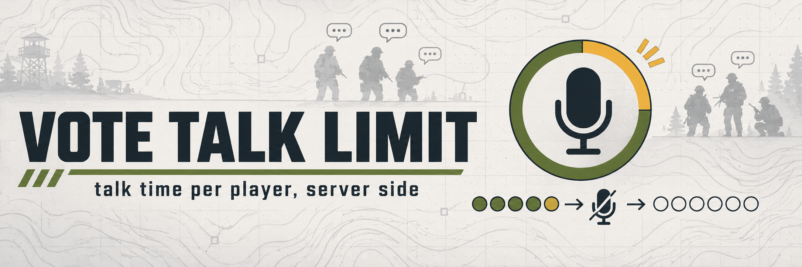

<picture>
  <source media="(prefers-color-scheme: dark)" srcset="./assets/banner-dark.png">
  
</picture>

# Squad-VoteTalkLimit

**Experimental Squad ModLoader ruleset that limits how long each player can talk during the end-of-match vote screens, so "top mid top mid" spam stops drowning everyone out.**

**English** · [Türkçe](./README_TR.md) · [Español](./README_ES.md) · [简体中文](./README_ZH.md) · [Русский](./README_RU.md)

[Install](#-installation) · [Highlights](#-highlights) · [Tutorial](./TUTORIAL.md) · [Changelog](./CHANGELOG.md)

---

## 🚧 Status
**Neither variant has been tested on a live server. Either one, or both, may not work.**

The server-side logic (the vote gate, the talk budget, the notices, the settings) compiles and follows the Squad SDK documentation. The open question is the last step: whether a server can actually cut a player's voice for everyone else. The SDK has no documented server call for that, and the voice functions it does expose look client-side. This repository ships two ways to try it so that a live test with two players can tell which one, if any, works.

---

## ✨ Highlights
- **Only during the vote** - the limit is active while the map vote or the faction vote runs. The scoreboard is never muted, and when the vote ends everybody can talk again
- **Talk budget, not a flat ban** - every player gets a budget of talk time that refills slowly. Normal speech passes untouched, a machine-gun repeat of the same call runs out of budget and gets a short mute
- **Safe by design** - nothing stays muted after the vote, after a disconnect or after a crash. The mute is tied to the lifetime of a small object that always dies with the vote
- **Players are told** - an info line when the limit starts, a warning one second before the mute, a line when muted and one when they can talk again
- **Everything is a server setting** - on/off, talk seconds and mute seconds, with defaults chosen by simulation
- **Two variants in one repository** - `server-only` and `client-rpc`, see below

---

## 🔀 The two variants
| | `server-only` | `client-rpc` |
|---|---|---|
| Idea | The server calls `ToggleMutePlayer` on every listener | The server spawns a tiny helper actor owned by the speaker. It replicates to that player's client only, and the client toggles its own voice |
| Files | `BP_VoteTalkLimit` | `BP_VoteTalkLimit` + `BP_VTLClientHelper` |
| Works if mute functions are client-side | Probably not | Possibly |
| Needs the mod on clients | No (ModLoader is still required) | Yes, clients load the helper |
| Cleanup | Server unmutes everybody | The helper is destroyed, its end toggles the voice back |
| Status | Untested | Untested |

The names are literal: `server-only` keeps everything on the server, `client-rpc` adds one piece that runs on the speaker's client.

---

## 📦 Installation
### Requirements

- Squad Server with the [ModLoader](https://steamcommunity.com/sharedfiles/filedetails/?id=3516838562) mod
- The Squad SDK (Unreal Editor) to open, compile and package the mod
- Two players for the voice test

### Built with

### Pick a variant

1. Download the release zip for the variant you want from the [latest release](https://github.com/Miabeyefendi/Squad-VoteTalkLimit/releases/latest): `VoteTalkLimit-server-only.zip` or `VoteTalkLimit-client-rpc.zip`.
2. Unzip it into `Squad/Plugins/Mods/` of your SDK. You get a folder named `VoteTalkLimit`.
3. Continue with the [tutorial](./TUTORIAL.md), which walks through compile, package, server setup and the voice test in order.

Install one variant at a time. Both use the mod name `VoteTalkLimit`.

### Release files

The two zips are the SDK mod folders (`.mi`, `.uplugin`, icon, preview and the Blueprint `.uasset` files) taken from `src/mod/<variant>/VoteTalkLimit`. They are not cooked. Rebuild them by zipping that folder with `VoteTalkLimit` at the root.

| File | SHA-256 | Purpose |
|---|---|---|
| `VoteTalkLimit-server-only.zip` | `599c70eff6808c441df307442fdc092ae66181087352d3f16f8d47626d95086c` | server-only variant |
| `VoteTalkLimit-client-rpc.zip` | `73dddefc3fd73bd020b8d52470c3766b0c9e8817e0129d6caf71afcdf425e1ee` | client-rpc variant |

---

## 🚀 Quick start
1. Install a variant (above).
2. Package the mod in the SDK and add it to your server through ModLoader.
3. Join the server with a second player and let a match end.
4. During the map vote, one player repeats a short call. The other listens.
5. Write down whether the speaker gets cut after about four seconds and whether they are heard again after the mute.

---

## ⚙️ Configuration
Settings are read from the server's `CustomOptions.cfg`. Every setting has a default inside the mod, so the file is optional.

| Setting | Default | Meaning |
|---|---|---|
| `VTL_Enabled` | `true` | Master switch |
| `VTL_TalkSeconds` | `4.0` | Talk budget in seconds (T) |
| `VTL_MuteSeconds` | `10.0` | Length of one mute in seconds (M) |

The budget refills at `T / (T + M)` seconds of talk per second. A player who empties the budget is muted for M seconds and then resumes with `M * T / (T + M)` seconds in hand.

---

## 🧠 How it works
1. Every tick the ruleset checks the vote state (`SQVotingState`). The gate is open while a map or faction vote is running.
2. For each player it reads a budget from a map keyed by player id. A new player gets a full budget and an info line.
3. If the player is talking (`RecentVoiceChannel` is not `None`) the budget drops by the frame time. Otherwise it refills.
4. When the budget reaches zero the player is muted and warned. When the refill brings it back to zero from below, they can talk again.
5. When the gate closes, every mute is released and the map is emptied.

### Simulation

A talk simulation (not live data) compared the defaults with no limit. With `T = 4`, `M = 10` a spam pattern stays audible about 30 percent of the time against 73 percent without the mod, while a continuous sentence of up to 5.6 seconds passes whole. With `T = 3`, `M = 8` a 5 second sentence is cut at about 4.1 seconds. The scripts are in [`tests/integration/`](./tests/integration/).

---

## ❓ FAQ
**Which variant should I use?** Try `client-rpc` first if you can install the mod on clients, since the server-side mute call is the less likely one to work. Test both if you can, and open an issue with what happened.

**Will it mute people on the scoreboard or in the match?** No. The gate only opens during the end-of-match votes.

**Can a player stay muted after leaving or after a crash?** The design says no for `client-rpc`: the mute lives and dies with a helper object. For `server-only` it is an open question: the server unmutes everybody when the vote ends, but whether a client keeps a toggled mute in its own settings is not verified. Please report any case where this is wrong.

**Why English notices?** The messages are plain strings in the Blueprint and can be edited in the SDK.

---

## 🤝 Contributing
Test results are the most useful contribution. Open an issue with the variant, the server setup and what you heard. See [CONTRIBUTING.md](./CONTRIBUTING.md).

---

## 🛡️ Security
See [SECURITY.md](./SECURITY.md).

---

## 📜 License
GNU Affero General Public License v3.0. See [LICENSE](./LICENSE) and [NOTICE](./NOTICE).

### Disclaimer

This project is not affiliated with or endorsed by Offworld Industries or the Squad team. It is an experiment and comes with no warranty.

---

## 📬 Contact
[Miabeyefendi on GitHub](https://github.com/Miabeyefendi)
