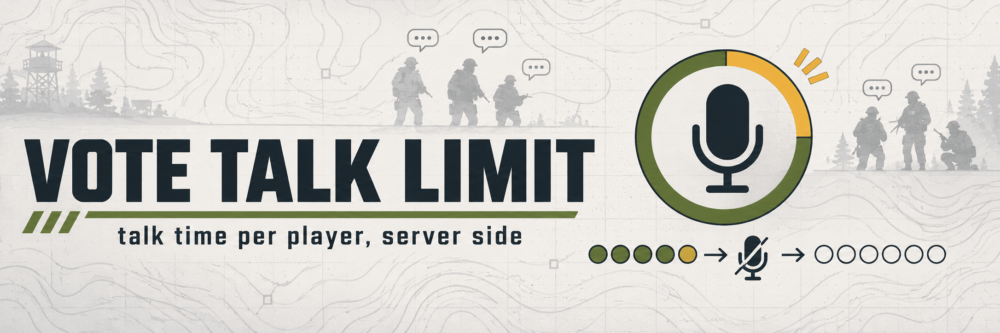

<div align="center">

<picture>
  <source media="(prefers-color-scheme: dark)" srcset="./assets/banner-dark.png">
  
</picture>

# Squad-VoteTalkLimit

**Ruleset experimental de ModLoader para Squad que limita cuánto puede hablar cada jugador durante las pantallas de votación de fin de partida, para que el spam de "arriba al medio arriba al medio" no tape a todos.**

[](./LICENSE)
[](https://github.com/Miabeyefendi/Squad-VoteTalkLimit/releases/latest)
[](#-instalación)
[](#-estado)
[](https://github.com/Miabeyefendi)

[English](./README.md) · [Türkçe](./README_TR.md) · **Español** · [简体中文](./README_ZH.md) · [Русский](./README_RU.md)

[Instalación](#-instalación) · [Características](#-características) · [Tutorial](./TUTORIAL_ES.md) · [Registro de cambios](./CHANGELOG.md)

</div>

---

## 🚧 Estado
**Ninguna de las dos variantes se ha probado en un servidor real. Una de ellas, o ambas, pueden no funcionar.**

La lógica del servidor (la puerta de votación, el presupuesto de voz, los avisos, los ajustes) compila y sigue la documentación del Squad SDK. La duda está en el último paso: si un servidor puede cortar de verdad la voz de un jugador para todos los demás. El SDK no documenta ninguna llamada de servidor para eso, y las funciones de voz que expone parecen del lado del cliente. Este repositorio ofrece dos formas de probarlo para que una prueba real con dos jugadores diga cuál funciona, si alguna.

**Comprobado el 2026-11-22.** Las dos variantes cargan en un servidor dedicado local de Windows (Squad 10.6) y las dos se ejecutaron en el editor del SDK (Play In Editor, un jugador local, una votación iniciada desde un script) sin errores de Blueprint ni cierres:

- la puerta se abre mientras corre una votación y se cierra al terminar, y entonces se limpia todo
- el jugador empieza con el presupuesto completo (4,0 s) y hablar lo gasta
- un presupuesto vacío se convierte en silencio, y el presupuesto vuelve al acabar el tiempo de silencio
- `client-rpc` crea `BP_VTLClientHelper`, propiedad del controlador del que habla, con una vida de unos segundos igual al tiempo de silencio, y desaparece cuando termina el silencio

**Sigue sin comprobarse:** si la voz se corta de verdad para los demás jugadores (hace falta un segundo jugador), los avisos en pantalla y la lectura de `CustomOptions.cfg` (Play In Editor no lo carga).

---

## ✨ Características
- **Solo durante la votación** - el límite está activo mientras corre la votación de mapa o de facción. El marcador nunca se silencia y, al terminar la votación, todos pueden hablar otra vez
- **Presupuesto de voz, no una prohibición fija** - cada jugador tiene un presupuesto de tiempo que se recarga despacio. El habla normal no se toca, repetir la misma llamada como una ametralladora agota el presupuesto y recibe un silencio corto
- **Seguro por diseño** - nada queda silenciado tras la votación, una desconexión o un fallo. El silencio está atado a la vida de un objeto pequeño que siempre muere con la votación
- **Se avisa a los jugadores** - una línea informativa al empezar el límite, un aviso un segundo antes del silencio, una línea al silenciar y otra al poder hablar de nuevo
- **Todo es un ajuste del servidor** - activado/desactivado, segundos de habla y segundos de silencio, con valores por defecto elegidos por simulación
- **Dos variantes en un repositorio** - `server-only` y `client-rpc`, ver abajo

---

## 🔀 Las dos variantes
| | `server-only` | `client-rpc` |
|---|---|---|
| Idea | El servidor llama a `ToggleMutePlayer` en cada oyente | El servidor crea un actor auxiliar pequeño propiedad del que habla. Se replica solo al cliente de ese jugador y el cliente cambia su propia voz |
| Archivos | `BP_VoteTalkLimit` | `BP_VoteTalkLimit` + `BP_VTLClientHelper` |
| Funciona si las funciones de silencio son del cliente | Probablemente no | Posiblemente |
| Necesita el mod en los clientes | No (ModLoader sigue siendo necesario) | Sí, los clientes cargan el auxiliar |
| Limpieza | El servidor reactiva a todos | Se destruye el auxiliar y su final devuelve la voz |
| Estado | Sin probar | Sin probar |

Los nombres son literales: `server-only` mantiene todo en el servidor, `client-rpc` añade una pieza que corre en el cliente del que habla.

---

## 📦 Instalación
### Requisitos

- Servidor de Squad con el mod [ModLoader](https://steamcommunity.com/sharedfiles/filedetails/?id=3516838562)
- El Squad SDK (Unreal Editor) para abrir, compilar y empaquetar el mod
- Dos jugadores para la prueba de voz

### Construido con


### Elige una variante

1. Descarga el zip de la variante que quieras desde la [última versión](https://github.com/Miabeyefendi/Squad-VoteTalkLimit/releases/latest): `VoteTalkLimit-server-only.zip` o `VoteTalkLimit-client-rpc.zip`.
2. Descomprímelo en `Squad/Plugins/Mods/` de tu SDK. Aparece una carpeta llamada `VoteTalkLimit`.
3. Sigue con el [tutorial](./TUTORIAL_ES.md), que recorre en orden compilar, empaquetar, configurar el servidor y la prueba de voz.

Instala una variante a la vez. Ambas usan el nombre de mod `VoteTalkLimit`.

### Archivos de la versión

Los dos zip son las carpetas del mod del SDK (`.mi`, `.uplugin`, icono, vista previa y los `.uasset` de Blueprint) tomadas de `src/mod/<variante>/VoteTalkLimit`. No están cocinados. Se reconstruyen comprimiendo esa carpeta con `VoteTalkLimit` en la raíz.

| Archivo | SHA-256 | Propósito |
|---|---|---|
| `VoteTalkLimit-server-only.zip` | `599c70eff6808c441df307442fdc092ae66181087352d3f16f8d47626d95086c` | variante server-only |
| `VoteTalkLimit-client-rpc.zip` | `73dddefc3fd73bd020b8d52470c3766b0c9e8817e0129d6caf71afcdf425e1ee` | variante client-rpc |
| `VoteTalkLimit-server-only-cooked.zip` | `9e71d506172480a1aea5a24e4cd5cae611a08388c0e89643dec602e4414b9d5b` | server-only variante empaquetada (paks de servidor y de cliente) |
| `VoteTalkLimit-client-rpc-cooked.zip` | `03493c7a6b2f532d2ba8c1c929669ba2d8bef36b1f95362f5034bb602a280e59` | client-rpc variante empaquetada (paks de servidor y de cliente) |

Los dos zips `-cooked` contienen el mod empaquetado (`.mi`, `.uplugin`, icono, vista previa y las carpetas `Content/Paks` para el servidor y el cliente). Se construyeron con el comando de cook del SDK 10.6 del [tutorial](./TUTORIAL_ES.md) y se comprobaron en un servidor local. Su `.mi` tiene `ID=0`, así que ponle antes un ID, mira las notas de configuración del servidor más abajo.

La variante `client-rpc` (0.1.1) también está subida al Steam Workshop para pruebas, ID `3844576818` ([enlace](https://steamcommunity.com/sharedfiles/filedetails/?id=3844576818)). Está como No listado (Unlisted): cualquiera con el enlace puede abrirla y los servidores pueden descargarla, pero no aparece en la búsqueda del Workshop. Los archivos `.mi` de este repositorio mantienen `ID=0`.

### Notas de configuración del servidor (comprobadas en un servidor local)

Estos puntos salieron de ejecutar un servidor dedicado real, no de la documentación.

- **Un mod local necesita un ID.** Un archivo `.mi` con `ID=0` se omite (`Failed to find a valid mod ID for VoteTalkLimit (needs to be uploaded to Steam)`). Para una prueba local pon cualquier número en `ID=` de la copia del servidor (y de la del cliente) y añádelo a `ModLoadOrder` en `ServerConfig/ModsConfig.cfg`. Para uso real, sube el mod al Workshop como elemento no listado.
- **Empieza en la capa de ModLoader.** Pon `ModLoader_v1` primero en la rotación. ModLoader lee entonces `SquadGame/Saved/ModLoader/ModLoader.json`.
- **`ModLoader.json` es de versión 2.** Las entradas son objetos con un indicador `true`. La forma antigua en lista se convierte sola y el archivo se reescribe:

```json
{
  "Version": 2,
  "rulesets": {
    "/VoteTalkLimit/BP_VoteTalkLimit.BP_VoteTalkLimit_C": true
  }
}
```

- **Empaquetado en SDK 10.6.** El botón de empaquetar del Modding Hub puede acabar en `Cook failed` porque assets propios del SDK (`BP_MutableSoldier`, `SQSquidBot`) dan errores por el módulo `SQAimAssist` que falta. El mod en sí está bien. El tutorial muestra el comando `BuildCookRun` con `-IgnoreCookErrors` que funciona.
- **Clientes.** Con `client-rpc` el mod también debe estar en el cliente. Hace falta una partida en marcha antes de que pueda empezar una votación, así que una prueba necesita al menos un jugador.

---

## 🚀 Inicio rápido
1. Instala una variante (arriba).
2. Empaqueta el mod en el SDK y añádelo a tu servidor con ModLoader.
3. Entra al servidor con un segundo jugador y deja que termine una partida.
4. Durante la votación de mapa, un jugador repite una llamada corta. El otro escucha.
5. Anota si al que habla se le corta tras unos cuatro segundos y si se le oye otra vez después del silencio.

---

## ⚙️ Configuración
Los ajustes se leen del `CustomOptions.cfg` del servidor. Cada ajuste tiene un valor por defecto dentro del mod, así que el archivo es opcional.

| Ajuste | Por defecto | Significado |
|---|---|---|
| `VTL_Enabled` | `true` | Interruptor general |
| `VTL_TalkSeconds` | `4.0` | Presupuesto de habla en segundos (T) |
| `VTL_MuteSeconds` | `10.0` | Duración de un silencio en segundos (M) |

El presupuesto se recarga a `T / (T + M)` segundos de habla por segundo. Un jugador que agota el presupuesto queda en silencio M segundos y luego sigue con `M * T / (T + M)` segundos en la mano.

---

## 🧠 Cómo funciona
1. En cada tick el ruleset comprueba el estado de la votación (`SQVotingState`). La puerta está abierta mientras corre una votación de mapa o de facción.
2. Para cada jugador lee un presupuesto de un mapa indexado por id de jugador. Un jugador nuevo recibe el presupuesto lleno y una línea informativa.
3. Si el jugador habla (`RecentVoiceChannel` no es `None`) el presupuesto baja el tiempo del fotograma. Si no, se recarga.
4. Cuando el presupuesto llega a cero el jugador se silencia y se avisa. Cuando la recarga lo devuelve a cero desde abajo, puede hablar otra vez.
5. Al cerrarse la puerta se liberan todos los silencios y se vacía el mapa.

### Simulación

Una simulación de habla (no son datos reales) comparó los valores por defecto con no tener límite. Con `T = 4`, `M = 10` un patrón de spam se oye alrededor del 30 por ciento del tiempo frente al 73 por ciento sin el mod, mientras que una frase continua de hasta 5,6 segundos pasa entera. Con `T = 3`, `M = 8` una frase de 5 segundos se corta hacia los 4,1 segundos. Los scripts están en [`tests/integration/`](./tests/integration/).

---

## ❓ Preguntas frecuentes
**¿Qué variante debo usar?** Prueba primero `client-rpc` si puedes instalar el mod en los clientes, porque la llamada de silencio desde el servidor es la menos probable de funcionar. Prueba ambas si puedes y abre un issue con lo que pasó.

**¿Hay una versión sin ModLoader?** No. Las dos variantes (`server-only` y `client-rpc`) son rulesets de ModLoader. Una vía vanilla como el plugin de SquadJS de [Smart Shuffle](https://github.com/Miabeyefendi/Squad-SmartShuffle) no es posible aquí, porque SquadJS no controla la voz.

**¿Silencia a la gente en el marcador o durante la partida?** No. La puerta solo se abre durante las votaciones de fin de partida.

**¿Puede un jugador quedar silenciado tras irse o tras un fallo?** Para `client-rpc` el diseño dice que no: el silencio vive y muere con un objeto auxiliar. Para `server-only` es una duda abierta: el servidor reactiva a todos al terminar la votación, pero no está verificado si un cliente conserva un silencio alternado en sus propios ajustes. Informa de cualquier caso en que esto falle.

**¿Por qué los avisos están en inglés?** Los mensajes son cadenas de texto simples en el Blueprint y se pueden editar en el SDK.

---

## 🤝 Contribuir
Los resultados de pruebas son la contribución más útil. Abre un issue con la variante, la configuración del servidor y lo que oíste. Consulta [CONTRIBUTING.md](./CONTRIBUTING.md).

---

## 🛡️ Seguridad
Consulta [SECURITY.md](./SECURITY.md).

---

## 📜 Licencia
GNU Affero General Public License v3.0. Consulta [LICENSE](./LICENSE) y [NOTICE](./NOTICE).

### Descargo de responsabilidad

Este proyecto no está afiliado a Offworld Industries ni al equipo de Squad, ni está respaldado por ellos. Es un experimento y no ofrece garantía.

---

## 📬 Contacto
[Miabeyefendi en GitHub](https://github.com/Miabeyefendi)
