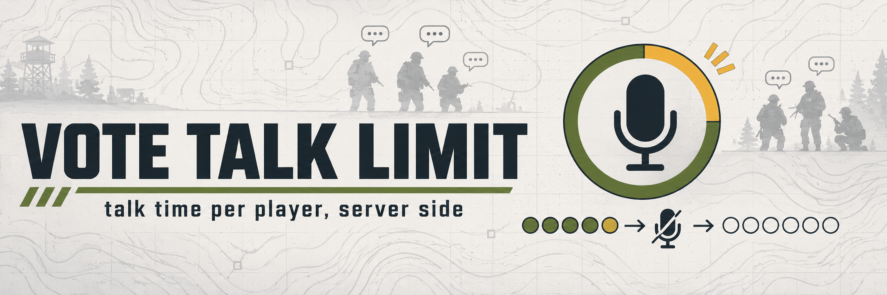

<div align="center">

<picture>
  <source media="(prefers-color-scheme: dark)" srcset="./assets/banner-dark.png">
  
</picture>

# Squad-VoteTalkLimit

**Экспериментальный ruleset ModLoader для Squad: ограничивает, как долго каждый игрок может говорить на экранах голосования после матча, чтобы спам вроде «справа сверху справа сверху» не заглушал всех.**

[](./LICENSE)
[](https://github.com/Miabeyefendi/Squad-VoteTalkLimit/releases/latest)
[](#-установка)
[](#-статус)
[](https://github.com/Miabeyefendi)

[English](./README.md) · [Türkçe](./README_TR.md) · [Español](./README_ES.md) · [简体中文](./README_ZH.md) · **Русский**

[Установка](#-установка) · [Возможности](#-возможности) · [Руководство](./TUTORIAL_RU.md) · [История изменений](./CHANGELOG.md)

</div>

---

## 🚧 Статус
**Ни один из двух вариантов не проверялся на живом сервере. Один из них или оба могут не работать.**

Серверная логика (ворота голосования, запас времени речи, уведомления, настройки) компилируется и следует документации Squad SDK. Открытый вопрос в последнем шаге: может ли сервер по-настоящему отключить голос игрока для всех остальных. В SDK нет документированного серверного вызова для этого, а голосовые функции, которые он открывает, выглядят клиентскими. Этот репозиторий предлагает два способа попробовать, чтобы живой тест с двумя игроками показал, какой из них работает, если вообще какой-то.

**Проверено 2026-11-22.** Оба варианта загружаются на локальном выделенном сервере Windows (Squad 10.6) и оба были запущены в редакторе SDK (Play In Editor, один локальный игрок, голосование запущено скриптом) без ошибок Blueprint и без сбоев:

- ворота открываются, пока идёт голосование, и закрываются, когда оно заканчивается, после чего всё очищается
- игрок начинает с полным запасом (4,0 с), речь его тратит
- пустой запас превращается в мут, а после времени мута запас возвращается
- `client-rpc` создаёт `BP_VTLClientHelper`, принадлежащий контроллеру говорящего, со временем жизни около времени мута, и он исчезает, когда мут заканчивается

**По-прежнему не проверено:** действительно ли голос обрывается для других игроков (нужен второй игрок), сообщения на экране и чтение `CustomOptions.cfg` (Play In Editor его не загружает).

---

## ✨ Возможности
- **Только во время голосования** - ограничение действует, пока идёт голосование за карту или за фракцию. Таблица результатов никогда не заглушается, а когда голосование заканчивается, все снова могут говорить
- **Запас времени речи, а не жёсткий запрет** - у каждого игрока есть запас времени речи, который медленно восстанавливается. Обычная речь не затрагивается, а очередь из одного и того же призыва исчерпывает запас и получает короткий мут
- **Безопасно по замыслу** - после голосования, отключения или сбоя никто не остаётся заглушённым. Мут привязан к жизни маленького объекта, который всегда исчезает вместе с голосованием
- **Игроков предупреждают** - строка с информацией при начале ограничения, предупреждение за секунду до мута, строка при муте и строка, когда снова можно говорить
- **Всё настраивается на сервере** - вкл/выкл, секунды речи и секунды мута, значения по умолчанию подобраны симуляцией
- **Два варианта в одном репозитории** - `server-only` и `client-rpc`, см. ниже

---

## 🔀 Два варианта
| | `server-only` | `client-rpc` |
|---|---|---|
| Идея | Сервер вызывает `ToggleMutePlayer` у каждого слушателя | Сервер создаёт маленький вспомогательный актор, принадлежащий говорящему. Он реплицируется только на клиент этого игрока, и клиент сам переключает свой голос |
| Файлы | `BP_VoteTalkLimit` | `BP_VoteTalkLimit` + `BP_VTLClientHelper` |
| Работает, если функции мута клиентские | Вероятно, нет | Возможно |
| Нужен мод на клиентах | Нет (ModLoader всё равно нужен) | Да, клиенты загружают помощника |
| Очистка | Сервер размучивает всех | Помощник уничтожается, его завершение возвращает голос |
| Статус | Не проверен | Не проверен |

Названия буквальные: `server-only` держит всё на сервере, `client-rpc` добавляет одну часть, которая работает на клиенте говорящего.

---

## 📦 Установка
### Требования

- Сервер Squad с модом [ModLoader](https://steamcommunity.com/sharedfiles/filedetails/?id=3516838562)
- Squad SDK (Unreal Editor), чтобы открыть, скомпилировать и упаковать мод
- Два игрока для проверки голоса

### Сделано с помощью


### Выберите вариант

1. Скачайте zip нужного варианта из [последнего релиза](https://github.com/Miabeyefendi/Squad-VoteTalkLimit/releases/latest): `VoteTalkLimit-server-only.zip` или `VoteTalkLimit-client-rpc.zip`.
2. Распакуйте в `Squad/Plugins/Mods/` вашего SDK. Появится папка `VoteTalkLimit`.
3. Переходите к [руководству](./TUTORIAL_RU.md), где по порядку описаны компиляция, упаковка, настройка сервера и проверка голоса.

Ставьте один вариант за раз. Оба используют имя мода `VoteTalkLimit`.

### Файлы релиза

Два zip это папки мода SDK (`.mi`, `.uplugin`, значок, превью и файлы Blueprint `.uasset`) из `src/mod/<вариант>/VoteTalkLimit`. Они не собраны (cook). Пересоберите их, упаковав эту папку так, чтобы `VoteTalkLimit` был в корне.

| Файл | SHA-256 | Назначение |
|---|---|---|
| `VoteTalkLimit-server-only.zip` | `599c70eff6808c441df307442fdc092ae66181087352d3f16f8d47626d95086c` | вариант server-only |
| `VoteTalkLimit-client-rpc.zip` | `73dddefc3fd73bd020b8d52470c3766b0c9e8817e0129d6caf71afcdf425e1ee` | вариант client-rpc |
| `VoteTalkLimit-server-only-cooked.zip` | `9e71d506172480a1aea5a24e4cd5cae611a08388c0e89643dec602e4414b9d5b` | server-only вариант, упакованный (pak для сервера и клиента) |
| `VoteTalkLimit-client-rpc-cooked.zip` | `03493c7a6b2f532d2ba8c1c929669ba2d8bef36b1f95362f5034bb602a280e59` | client-rpc вариант, упакованный (pak для сервера и клиента) |

Два архива `-cooked` содержат упакованный мод (`.mi`, `.uplugin`, значок, превью и папки `Content/Paks` для сервера и клиента). Они собраны командой cook для SDK 10.6 из [руководства](./TUTORIAL_RU.md) и проверены на локальном сервере. В их `.mi` стоит `ID=0`, поэтому сначала задайте ID, см. заметки по настройке сервера ниже.

Вариант `client-rpc` (0.1.1) также загружен в Steam Workshop для проверки, ID `3844576818` ([ссылка](https://steamcommunity.com/sharedfiles/filedetails/?id=3844576818)). Видимость: «Не в списке» (Unlisted): открыть может любой, у кого есть ссылка, серверы могут его скачать, но в поиске Workshop он не показывается. Файлы `.mi` в этом репозитории остаются с `ID=0`.

### Заметки по настройке сервера (проверено на локальном сервере)

Эти пункты получены запуском настоящего выделенного сервера, а не из документации.

- **Локальному моду нужен ID.** Файл `.mi` с `ID=0` пропускается (`Failed to find a valid mod ID for VoteTalkLimit (needs to be uploaded to Steam)`). Для локального теста впишите любое число в `ID=` копии на сервере (и копии на клиенте) и добавьте его в `ModLoadOrder` в `ServerConfig/ModsConfig.cfg`. Для реального использования загрузите мод в Workshop (достаточно видимости «Не в списке»).
- **Начинайте со слоя ModLoader.** Поставьте `ModLoader_v1` первым в ротации. Затем ModLoader читает `SquadGame/Saved/ModLoader/ModLoader.json`.
- **`ModLoader.json` версии 2.** Записи это объекты с флагом `true`. Старый вид списком преобразуется автоматически, файл перезаписывается:

```json
{
  "Version": 2,
  "rulesets": {
    "/VoteTalkLimit/BP_VoteTalkLimit.BP_VoteTalkLimit_C": true
  }
}
```

- **Упаковка в SDK 10.6.** Кнопка упаковки в Modding Hub может закончиться `Cook failed`, потому что собственные ассеты SDK (`BP_MutableSoldier`, `SQSquidBot`) выдают ошибки из-за отсутствующего модуля `SQAimAssist`. Сам мод в порядке. В руководстве есть рабочая команда `BuildCookRun` с `-IgnoreCookErrors`.
- **Клиенты.** С `client-rpc` мод должен быть и на клиенте. Голосование не начнётся, пока не идёт матч, поэтому для теста нужен хотя бы один игрок.

---

## 🚀 Быстрый старт
1. Установите вариант (выше).
2. Упакуйте мод в SDK и добавьте его на сервер через ModLoader.
3. Зайдите на сервер со вторым игроком и дождитесь конца матча.
4. Во время голосования за карту один игрок повторяет короткий призыв. Другой слушает.
5. Запишите, обрывается ли говорящий примерно через четыре секунды и слышно ли его снова после мута.

---

## ⚙️ Настройка
Настройки читаются из `CustomOptions.cfg` сервера. У каждой настройки есть значение по умолчанию внутри мода, так что файл необязателен.

| Настройка | По умолчанию | Значение |
|---|---|---|
| `VTL_Enabled` | `true` | Главный выключатель |
| `VTL_TalkSeconds` | `4.0` | Запас времени речи в секундах (T) |
| `VTL_MuteSeconds` | `10.0` | Длина одного мута в секундах (M) |

Запас восстанавливается со скоростью `T / (T + M)` секунд речи в секунду. Игрок, исчерпавший запас, заглушается на M секунд, а затем продолжает с запасом `M * T / (T + M)` секунд.

---

## 🧠 Как это работает
1. На каждом тике ruleset проверяет состояние голосования (`SQVotingState`). Ворота открыты, пока идёт голосование за карту или за фракцию.
2. Для каждого игрока он читает запас из карты, ключом которой служит id игрока. Новый игрок получает полный запас и строку с информацией.
3. Если игрок говорит (`RecentVoiceChannel` не `None`), запас уменьшается на время кадра. Иначе восстанавливается.
4. Когда запас доходит до нуля, игрок заглушается и получает предупреждение. Когда восстановление возвращает его к нулю снизу, игрок может говорить снова.
5. Когда ворота закрываются, все муты снимаются, а карта очищается.

### Симуляция

Симуляция речи (не живые данные) сравнила значения по умолчанию с отсутствием ограничения. При `T = 4`, `M = 10` спам слышен примерно 30 процентов времени против 73 процентов без мода, а непрерывная фраза до 5,6 секунды проходит целиком. При `T = 3`, `M = 8` фраза в 5 секунд обрывается примерно на 4,1 секунды. Скрипты лежат в [`tests/integration/`](./tests/integration/).

---

## ❓ Вопросы и ответы
**Какой вариант выбрать?** Сначала попробуйте `client-rpc`, если можете поставить мод на клиенты, потому что серверный вызов мута вероятнее всего не сработает. Если можете, проверьте оба и откройте issue с результатом.

**Есть ли версия без ModLoader?** Нет. Оба варианта (`server-only` и `client-rpc`) это ruleset для ModLoader. Ванильный путь, как плагин SquadJS в [Smart Shuffle](https://github.com/Miabeyefendi/Squad-SmartShuffle), здесь невозможен, потому что в SquadJS нет управления голосом.

**Заглушает ли он на экране результатов или во время матча?** Нет. Ворота открываются только во время голосований после матча.

**Может ли игрок остаться заглушённым после выхода или сбоя?** Для `client-rpc` замысел говорит, что нет: мут живёт и умирает вместе со вспомогательным объектом. Для `server-only` это открытый вопрос: сервер размучивает всех, когда голосование заканчивается, но не проверено, сохраняет ли клиент переключённый мут в своих настройках. Сообщите о любом случае, когда это не так.

**Почему уведомления на английском?** Сообщения в Blueprint это обычные строки, их можно изменить в SDK.

---

## 🤝 Участие
Самый полезный вклад это результаты тестов. Откройте issue с вариантом, настройкой сервера и тем, что вы услышали. См. [CONTRIBUTING.md](./CONTRIBUTING.md).

---

## 🛡️ Безопасность
См. [SECURITY.md](./SECURITY.md).

---

## 📜 Лицензия
GNU Affero General Public License v3.0. См. [LICENSE](./LICENSE) и [NOTICE](./NOTICE).

### Отказ от ответственности

Проект не связан с Offworld Industries или командой Squad и не одобрен ими. Это эксперимент, гарантий нет.

---

## 📬 Контакты
[Miabeyefendi на GitHub](https://github.com/Miabeyefendi)
