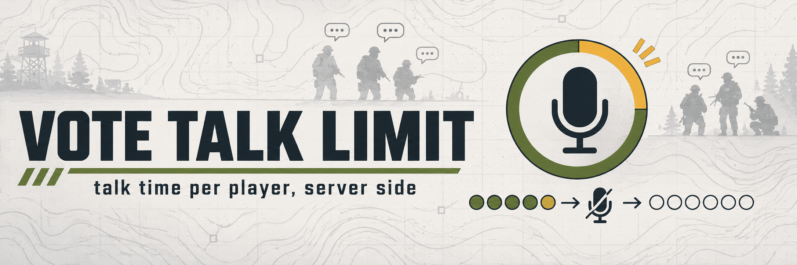

<div align="center">

<picture>
  <source media="(prefers-color-scheme: dark)" srcset="./assets/banner-dark.png">
  
</picture>

# Squad-VoteTalkLimit

**Squad için deneysel ModLoader ruleset'i: maç sonu oylama ekranlarında her oyuncunun konuşma süresini sınırlar, böylece "sağ üst sağ üst" spamı herkesin sesini bastırmaz.**

[](./LICENSE)
[](https://github.com/Miabeyefendi/Squad-VoteTalkLimit/releases/latest)
[](#-kurulum)
[](#-durum)
[](https://github.com/Miabeyefendi)

[English](./README.md) · **Türkçe** · [Español](./README_ES.md) · [简体中文](./README_ZH.md) · [Русский](./README_RU.md)

[Kurulum](#-kurulum) · [Öne çıkanlar](#-öne-çıkanlar) · [Rehber](./TUTORIAL_TR.md) · [Değişiklik günlüğü](./CHANGELOG.md)

</div>

---

## 🚧 Durum
**İki varyant da canlı sunucuda denenmedi. Biri ya da ikisi birden çalışmayabilir.**

Sunucu tarafındaki mantık (oylama kapısı, konuşma bütçesi, bildirimler, ayarlar) derleniyor ve Squad SDK belgelerine uyuyor. Açık soru son adımda: sunucu bir oyuncunun sesini diğer herkes için gerçekten kesebilir mi? SDK'da bunun için belgelenmiş bir sunucu çağrısı yok, sunduğu ses fonksiyonları da istemci tarafı gibi duruyor. Bu depo, iki oyuncuyla yapılacak canlı bir testin hangisinin (varsa) çalıştığını göstermesi için iki yol sunar.

**2026-11-22'de denendi.** İki varyant da yerel bir Windows dedicated sunucuda (Squad 10.6) yükleniyor ve ikisi de SDK editöründe (Play In Editor, tek yerel oyuncu, oylama bir betikle başlatıldı) çalıştırıldı. Blueprint hatası ve çökme yok:

- kapı oylama sürerken açılıyor, oylama bitince kapanıyor ve her şey temizleniyor
- oyuncu tam bütçeyle (4,0 sn) başlıyor, konuşmak bütçeyi tüketiyor
- bütçe bitince mute başlıyor, mute süresi dolunca bütçe geri geliyor
- `client-rpc`, konuşanın kontrolcüsüne ait `BP_VTLClientHelper` yardımcısını doğuruyor, ömrü yaklaşık mute süresi kadar ve mute bitince yok oluyor

**Hâlâ doğrulanmadı:** sesin diğer oyuncular için gerçekten kesilip kesilmediği (ikinci oyuncu gerekir), ekran mesajları ve `CustomOptions.cfg` okuması (Play In Editor bu dosyayı yüklemiyor).

---

## ✨ Öne çıkanlar
- **Sadece oylama sırasında** - sınır harita oylaması ya da faction oylaması sürerken açıktır. Scoreboard asla susturulmaz, oylama bitince herkes tekrar konuşabilir
- **Düz yasak değil, konuşma bütçesi** - her oyuncunun yavaş dolan bir konuşma bütçesi vardır. Normal konuşma etkilenmez, aynı çağrıyı makineli tüfek gibi tekrarlayan oyuncunun bütçesi biter ve kısa süre susturulur
- **Güvenli tasarım** - oylamadan, bağlantı kopmasından ya da çökmeden sonra hiçbir şey susturulmuş kalmaz. Mute, oylamayla birlikte her zaman ölen küçük bir nesnenin ömrüne bağlıdır
- **Oyuncular bilgilendirilir** - sınır başlarken bilgi satırı, mute'tan bir saniye önce uyarı, susturulunca ve tekrar konuşabilince birer satır
- **Her şey sunucu ayarı** - açık/kapalı, konuşma saniyesi ve mute saniyesi, varsayılanlar simülasyonla seçildi
- **Tek depoda iki varyant** - `server-only` ve `client-rpc`, aşağıya bak

---

## 🔀 İki varyant
| | `server-only` | `client-rpc` |
|---|---|---|
| Fikir | Sunucu her dinleyicide `ToggleMutePlayer` çağırır | Sunucu konuşana ait küçük bir yardımcı aktör doğurur. Sadece o oyuncunun istemcisine kopyalanır ve istemci kendi sesini değiştirir |
| Dosyalar | `BP_VoteTalkLimit` | `BP_VoteTalkLimit` + `BP_VTLClientHelper` |
| Mute fonksiyonları istemci tarafıysa çalışır mı | Büyük ihtimalle hayır | Belki |
| İstemcide mod gerekir mi | Hayır (ModLoader yine gerekli) | Evet, istemciler yardımcıyı yükler |
| Temizlik | Sunucu herkesi açar | Yardımcı yok edilir, bitişi sesi geri açar |
| Durum | Denenmedi | Denenmedi |

İsimler kelimenin tam anlamıyla: `server-only` her şeyi sunucuda tutar, `client-rpc` konuşanın istemcisinde çalışan bir parça ekler.

---

## 📦 Kurulum
### Gereksinimler

- [ModLoader](https://steamcommunity.com/sharedfiles/filedetails/?id=3516838562) modu olan bir Squad sunucusu
- Modu açmak, derlemek ve paketlemek için Squad SDK (Unreal Editor)
- Ses testi için iki oyuncu

### Kullanılan teknolojiler


### Varyant seç

1. İstediğin varyantın zip'ini [son sürümden](https://github.com/Miabeyefendi/Squad-VoteTalkLimit/releases/latest) indir: `VoteTalkLimit-server-only.zip` ya da `VoteTalkLimit-client-rpc.zip`.
2. SDK'nın `Squad/Plugins/Mods/` klasörüne aç. `VoteTalkLimit` adlı bir klasör çıkar.
3. Derleme, paketleme, sunucu kurulumu ve ses testini sırayla anlatan [rehbere](./TUTORIAL_TR.md) geç.

Aynı anda tek varyant kur. İkisi de `VoteTalkLimit` mod adını kullanır.

### Sürüm dosyaları

İki zip, `src/mod/<varyant>/VoteTalkLimit` içindeki SDK mod klasörleridir (`.mi`, `.uplugin`, simge, önizleme ve Blueprint `.uasset` dosyaları). Pişirilmemiştir. Kökte `VoteTalkLimit` olacak şekilde o klasörü zipleyerek yeniden üretebilirsin.

| Dosya | SHA-256 | Amaç |
|---|---|---|
| `VoteTalkLimit-server-only.zip` | `599c70eff6808c441df307442fdc092ae66181087352d3f16f8d47626d95086c` | server-only varyantı |
| `VoteTalkLimit-client-rpc.zip` | `73dddefc3fd73bd020b8d52470c3766b0c9e8817e0129d6caf71afcdf425e1ee` | client-rpc varyantı |
| `VoteTalkLimit-server-only-cooked.zip` | `9e71d506172480a1aea5a24e4cd5cae611a08388c0e89643dec602e4414b9d5b` | server-only varyantı, paketlenmiş (sunucu ve istemci pak dosyaları) |
| `VoteTalkLimit-client-rpc-cooked.zip` | `03493c7a6b2f532d2ba8c1c929669ba2d8bef36b1f95362f5034bb602a280e59` | client-rpc varyantı, paketlenmiş (sunucu ve istemci pak dosyaları) |

İki `-cooked` zip paketlenmiş modu içerir (`.mi`, `.uplugin`, simge, önizleme ve sunucu ile istemci için `Content/Paks` klasörleri). [Rehberdeki](./TUTORIAL_TR.md) SDK 10.6 cook komutuyla üretildi ve yerel sunucuda denendi. `.mi` dosyalarında `ID=0` var, önce bir ID ver, aşağıdaki sunucu kurulum notlarına bak.

`client-rpc` varyantı (0.1.1) test için Steam Workshop'a da yüklendi, ID `3844006456` ([bağlantı](https://steamcommunity.com/sharedfiles/filedetails/?id=3844006456)). Şimdilik gizli, yani görünürlük değiştirilene kadar bağlantı sadece yükleyen hesapta çalışır. Sunucular Workshop modlarını anonim indirir, bu yüzden gizli bir öğe henüz sunucuda kullanılamaz. Bu depodaki `.mi` dosyaları `ID=0` olarak kalır.

### Sunucu kurulum notları (yerel sunucuda denendi)

Bu maddeler belgeden değil, gerçek bir dedicated sunucu çalıştırılarak bulundu.

- **Yerel modun ID'si olmalı.** `.mi` dosyasında `ID=0` varsa mod atlanır (`Failed to find a valid mod ID for VoteTalkLimit (needs to be uploaded to Steam)`). Yerel testte sunucudaki kopyanın (ve istemci kopyasının) `ID=` satırına herhangi bir sayı yaz ve `ServerConfig/ModsConfig.cfg` içindeki `ModLoadOrder` listesine ekle. Gerçek kullanımda modu Workshop'a listelenmemiş öğe olarak yükle.
- **ModLoader katmanıyla başla.** Rotasyonda `ModLoader_v1` ilk sırada olsun. ModLoader sonra `SquadGame/Saved/ModLoader/ModLoader.json` dosyasını okur.
- **`ModLoader.json` sürüm 2.** Girdiler `true` bayraklı nesnelerdir. Eski liste biçimi otomatik dönüştürülür ve dosya yeniden yazılır:

```json
{
  "Version": 2,
  "rulesets": {
    "/VoteTalkLimit/BP_VoteTalkLimit.BP_VoteTalkLimit_C": true
  }
}
```

- **SDK 10.6'da paketleme.** Modding Hub'ın paketle düğmesi `Cook failed` ile bitebilir, çünkü SDK'nın kendi varlıkları (`BP_MutableSoldier`, `SQSquidBot`) eksik `SQAimAssist` modülü yüzünden hata basar. Mod sorunsuzdur. Rehberde `-IgnoreCookErrors` ile çalışan `BuildCookRun` komutu var.
- **İstemciler.** `client-rpc` ile mod istemcide de olmalı. Oylama başlamadan önce bir maçın çalışıyor olması gerekir, yani test için en az bir oyuncu lazım.

---

## 🚀 Hızlı başlangıç
1. Bir varyantı kur (yukarıda).
2. Modu SDK'da paketle ve ModLoader ile sunucuna ekle.
3. İkinci bir oyuncuyla sunucuya gir ve bir maçın bitmesini bekle.
4. Harita oylamasında bir oyuncu kısa bir çağrıyı tekrar etsin. Diğeri dinlesin.
5. Konuşanın yaklaşık dört saniye sonra kesilip kesilmediğini ve mute'tan sonra tekrar duyulup duyulmadığını not et.

---

## ⚙️ Yapılandırma
Ayarlar sunucunun `CustomOptions.cfg` dosyasından okunur. Her ayarın mod içinde varsayılanı vardır, dosya isteğe bağlıdır.

| Ayar | Varsayılan | Anlamı |
|---|---|---|
| `VTL_Enabled` | `true` | Ana anahtar |
| `VTL_TalkSeconds` | `4.0` | Saniye cinsinden konuşma bütçesi (T) |
| `VTL_MuteSeconds` | `10.0` | Bir mute'un saniye cinsinden uzunluğu (M) |

Bütçe saniyede `T / (T + M)` saniye konuşma hızıyla dolar. Bütçesini bitiren oyuncu M saniye susturulur, sonra elinde `M * T / (T + M)` saniye ile devam eder.

---

## 🧠 Nasıl çalışır
1. Ruleset her tick'te oylama durumunu (`SQVotingState`) kontrol eder. Harita ya da faction oylaması sürerken kapı açıktır.
2. Her oyuncu için oyuncu kimliğine bağlı bir haritadan bütçeyi okur. Yeni oyuncu dolu bütçe ve bir bilgi satırı alır.
3. Oyuncu konuşuyorsa (`RecentVoiceChannel` `None` değil) bütçe kare süresi kadar azalır, değilse dolar.
4. Bütçe sıfıra inince oyuncu susturulur ve uyarılır. Dolum bütçeyi eksiden sıfıra getirince tekrar konuşabilir.
5. Kapı kapanınca bütün mute'lar kaldırılır ve harita boşaltılır.

### Simülasyon

Bir konuşma simülasyonu (canlı veri değil) varsayılanları sınırsız durumla karşılaştırdı. `T = 4`, `M = 10` ile spam kalıbı yaklaşık yüzde 30 duyulur, modsuz ise yüzde 73. 5,6 saniyeye kadar kesintisiz bir cümle ise bütün geçer. `T = 3`, `M = 8` ile 5 saniyelik bir cümle yaklaşık 4,1 saniyede kesilir. Betikler [`tests/integration/`](./tests/integration/) içinde.

---

## ❓ SSS
**Hangi varyantı kullanmalıyım?** Modu istemcilere kurabiliyorsan önce `client-rpc` dene, çünkü sunucudan mute çağrısının çalışma ihtimali daha düşük. Mümkünse ikisini de dene ve ne olduğunu issue olarak yaz.

**Scoreboard'da ya da maç içinde susturur mu?** Hayır. Kapı sadece maç sonu oylamalarında açılır.

**Oyuncu ayrıldıktan ya da çöktükten sonra susturulmuş kalabilir mi?** `client-rpc` için tasarım hayır diyor: mute bir yardımcı nesneyle yaşar ve ölür. `server-only` için açık soru: sunucu oylama bitince herkesi açar ama istemcinin değiştirilmiş mute'u kendi ayarında tutup tutmadığı doğrulanmadı. Yanlış olduğu bir durum görürsen bildir.

**Bildirimler neden İngilizce?** Mesajlar Blueprint içinde düz metindir, SDK'da değiştirilebilir.

---

## 🤝 Katkı
En faydalı katkı test sonucudur. Varyantı, sunucu kurulumunu ve ne duyduğunu issue olarak aç. Bkz. [CONTRIBUTING.md](./CONTRIBUTING.md).

---

## 🛡️ Güvenlik
Bkz. [SECURITY.md](./SECURITY.md).

---

## 📜 Lisans
GNU Affero General Public License v3.0. Bkz. [LICENSE](./LICENSE) ve [NOTICE](./NOTICE).

### Sorumluluk reddi

Bu proje Offworld Industries ya da Squad ekibiyle bağlantılı değildir ve onlar tarafından onaylanmamıştır. Bir deneydir, garanti verilmez.

---

## 📬 İletişim
[GitHub'da Miabeyefendi](https://github.com/Miabeyefendi)
