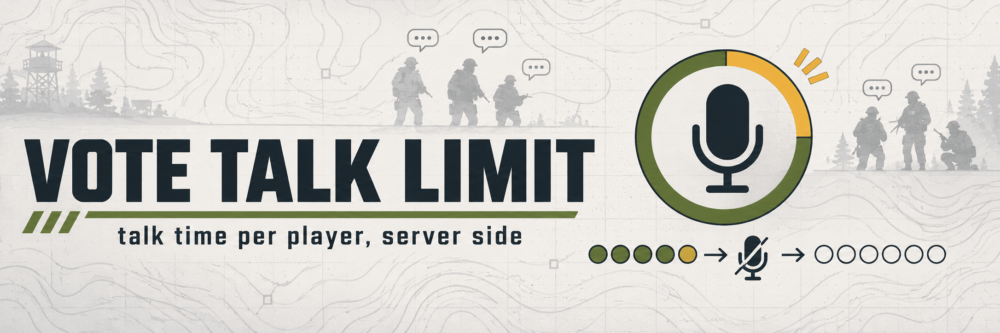

<picture>
  <source media="(prefers-color-scheme: dark)" srcset="./assets/banner-dark.png">
  
</picture>

# Squad-VoteTalkLimit

**适用于 Squad 的实验性 ModLoader ruleset：在对局结束后的投票界面限制每名玩家的说话时长，避免“右上右上”式的刷屏盖过所有人。**

[English](./README.md) · [Türkçe](./README_TR.md) · [Español](./README_ES.md) · **简体中文** · [Русский](./README_RU.md)

[安装](#-安装) · [亮点](#-亮点) · [教程](./TUTORIAL_ZH.md) · [更新日志](./CHANGELOG.md)

---

## 🚧 状态
**两个变体都没有在真实服务器上测试过。其中一个或两个都可能无法工作。**

服务器端的逻辑（投票开关、说话额度、提示、设置）可以编译，并遵循 Squad SDK 文档。未解决的问题在最后一步：服务器能否真正对其他所有人切断某名玩家的语音。SDK 没有为此提供文档化的服务器调用，它公开的语音函数看起来属于客户端。本仓库提供两种尝试方式，以便用两名玩家做一次真实测试，看看哪一种（如果有）有效。

---

## ✨ 亮点
- **仅在投票期间** - 限制只在地图投票或阵营投票进行时生效。计分板从不静音，投票结束后所有人立即恢复说话
- **说话额度而不是一刀切** - 每名玩家有一份缓慢回复的说话额度。正常说话不受影响，像机关枪一样重复同一句呼叫会耗尽额度并被短暂静音
- **设计上安全** - 投票后、断线后或崩溃后都不会有人一直被静音。静音与一个小对象的生命周期绑定，这个对象总会随投票一起消失
- **会通知玩家** - 限制开始时一条提示，静音前一秒一条警告，被静音时一条，可以重新说话时一条
- **一切都是服务器设置** - 开关、说话秒数和静音秒数，默认值通过模拟选定
- **一个仓库两个变体** - `server-only` 与 `client-rpc`，见下文

---

## 🔀 两个变体
| | `server-only` | `client-rpc` |
|---|---|---|
| 思路 | 服务器对每个听者调用 `ToggleMutePlayer` | 服务器生成一个属于说话者的小型辅助 actor。它只复制到该玩家的客户端，由客户端切换自己的语音 |
| 文件 | `BP_VoteTalkLimit` | `BP_VoteTalkLimit` + `BP_VTLClientHelper` |
| 静音函数若属于客户端是否有效 | 大概不行 | 可能有效 |
| 客户端是否需要该 mod | 不需要（仍需要 ModLoader） | 需要，客户端会加载辅助 actor |
| 清理 | 服务器解除所有人的静音 | 辅助 actor 被销毁，它的结束会把语音切换回来 |
| 状态 | 未测试 | 未测试 |

名称按字面理解：`server-only` 把一切放在服务器上，`client-rpc` 增加一个在说话者客户端上运行的部分。

---

## 📦 安装
### 要求

- 安装了 [ModLoader](https://steamcommunity.com/sharedfiles/filedetails/?id=3516838562) mod 的 Squad 服务器
- 用于打开、编译和打包 mod 的 Squad SDK（Unreal Editor）
- 两名玩家用于语音测试

### 构建于

### 选择变体

1. 从[最新版本](https://github.com/Miabeyefendi/Squad-VoteTalkLimit/releases/latest)下载所需变体的 zip：`VoteTalkLimit-server-only.zip` 或 `VoteTalkLimit-client-rpc.zip`。
2. 解压到 SDK 的 `Squad/Plugins/Mods/`。会得到名为 `VoteTalkLimit` 的文件夹。
3. 继续阅读[教程](./TUTORIAL_ZH.md)，它按顺序讲解编译、打包、服务器设置和语音测试。

一次只安装一个变体。两者都使用 mod 名称 `VoteTalkLimit`。

### 发布文件

两个 zip 是取自 `src/mod/<variant>/VoteTalkLimit` 的 SDK mod 文件夹（`.mi`、`.uplugin`、图标、预览图和 Blueprint `.uasset` 文件），未经烘焙。把该文件夹压缩并让 `VoteTalkLimit` 位于根目录即可重新生成。

| 文件 | SHA-256 | 用途 |
|---|---|---|
| `VoteTalkLimit-server-only.zip` | `599c70eff6808c441df307442fdc092ae66181087352d3f16f8d47626d95086c` | server-only 变体 |
| `VoteTalkLimit-client-rpc.zip` | `73dddefc3fd73bd020b8d52470c3766b0c9e8817e0129d6caf71afcdf425e1ee` | client-rpc 变体 |

---

## 🚀 快速开始
1. 安装一个变体（见上）。
2. 在 SDK 中打包 mod，并通过 ModLoader 添加到服务器。
3. 与第二名玩家进入服务器，等待一局结束。
4. 在地图投票期间，一名玩家重复一句简短的呼叫，另一名玩家聆听。
5. 记录说话者是否在大约四秒后被切断，以及静音结束后是否又能被听到。

---

## ⚙️ 配置
设置从服务器的 `CustomOptions.cfg` 读取。每项设置在 mod 内都有默认值，所以该文件是可选的。

| 设置 | 默认值 | 含义 |
|---|---|---|
| `VTL_Enabled` | `true` | 总开关 |
| `VTL_TalkSeconds` | `4.0` | 说话额度秒数 (T) |
| `VTL_MuteSeconds` | `10.0` | 一次静音的秒数 (M) |

额度以每秒 `T / (T + M)` 秒说话时间的速度回复。额度耗尽的玩家会被静音 M 秒，然后带着 `M * T / (T + M)` 秒的额度继续。

---

## 🧠 工作原理
1. ruleset 每个 tick 检查投票状态（`SQVotingState`）。地图或阵营投票进行时开关打开。
2. 对每名玩家，从以玩家 id 为键的映射中读取额度。新玩家获得满额度和一条提示。
3. 如果玩家在说话（`RecentVoiceChannel` 不是 `None`），额度按帧时间减少，否则回复。
4. 额度降到零时玩家被静音并收到警告。当回复把额度从负值带回零时，玩家可以再次说话。
5. 开关关闭时，所有静音被解除，映射被清空。

### 模拟

一次说话模拟（不是真实数据）比较了默认值与无限制的情况。在 `T = 4`、`M = 10` 下，刷屏模式大约有 30% 的时间能被听到，不用本 mod 则为 73%，而长达 5.6 秒的连续句子可以完整通过。在 `T = 3`、`M = 8` 下，5 秒的句子大约在 4.1 秒处被切断。脚本在 [`tests/integration/`](./tests/integration/)。

---

## ❓ 常见问题
**该用哪个变体？** 如果能在客户端安装 mod，先试 `client-rpc`，因为服务器端的静音调用最不可能生效。能的话两个都测，并开一个 issue 说明结果。

**会在计分板或对局中静音吗？** 不会。开关只在对局结束后的投票期间打开。

**玩家离开或崩溃后会一直被静音吗？** 对 `client-rpc`，设计上不会：静音随一个辅助对象生灭。对 `server-only` 这是未解决的问题：服务器在投票结束时解除所有人，但客户端是否会在自己的设置中保留被切换的静音尚未验证。如果发现不符的情况，请报告。

**为什么提示是英文？** 消息是 Blueprint 里的普通字符串，可以在 SDK 中修改。

---

## 🤝 贡献
测试结果是最有价值的贡献。请开一个 issue，写明变体、服务器设置和你听到的情况。参见 [CONTRIBUTING.md](./CONTRIBUTING.md)。

---

## 🛡️ 安全
参见 [SECURITY.md](./SECURITY.md)。

---

## 📜 许可证
GNU Affero General Public License v3.0。参见 [LICENSE](./LICENSE) 和 [NOTICE](./NOTICE)。

### 免责声明

本项目与 Offworld Industries 或 Squad 团队无关，也未获得其认可。这是一个实验，不提供任何担保。

---

## 📬 联系
[GitHub 上的 Miabeyefendi](https://github.com/Miabeyefendi)
